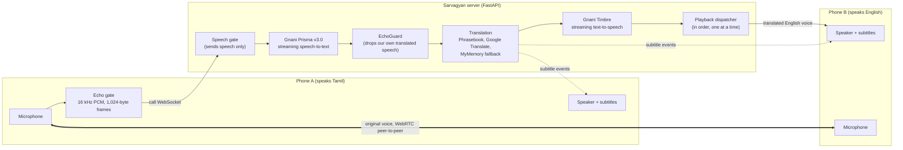
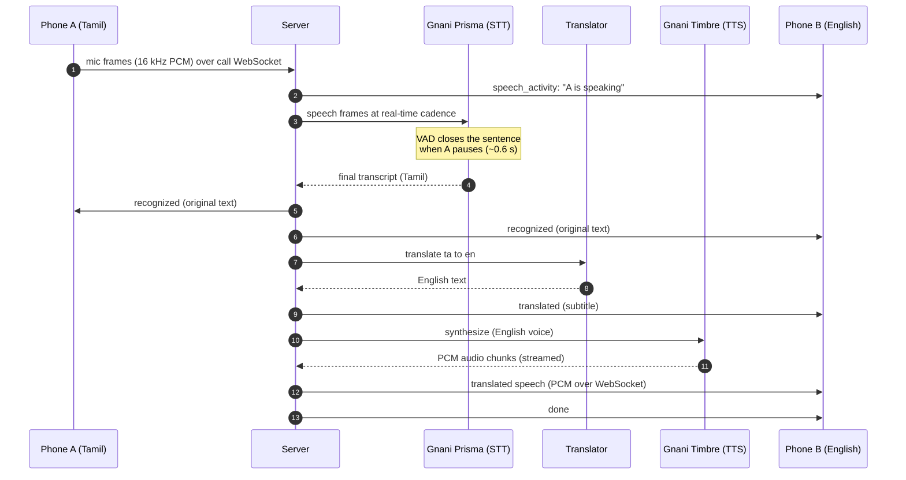
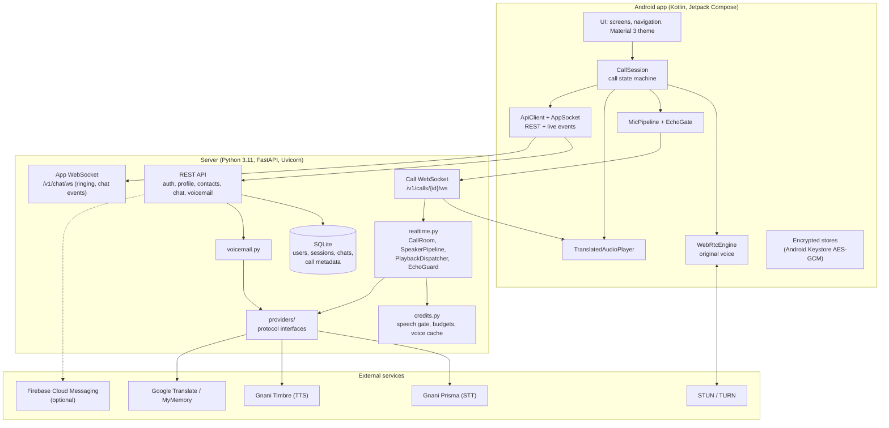
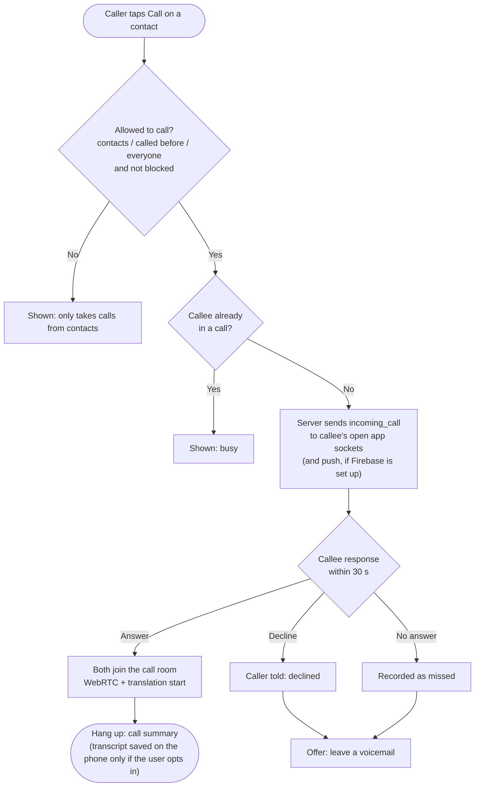
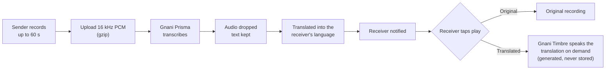
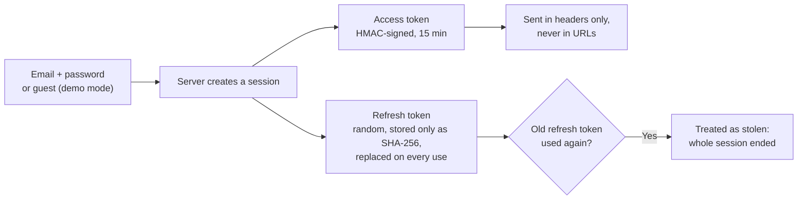
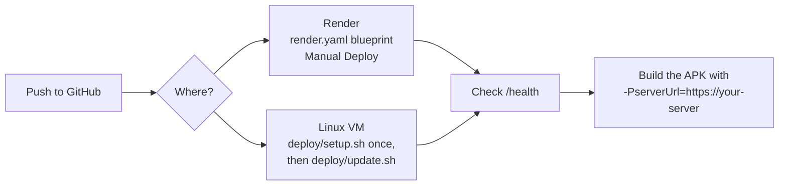

<div align="center">

# Sarvagyan

### Speak. Understand. Connect.

**Real-time translated calling for India.** Two people who speak different languages call each other;
each speaks their own language and hears the other in theirs, with live subtitles on both screens.


Built for the **Gnani AI Internship Challenge** by **Siva Sanjay** (AI & ML) and **Dhanuja** (Software).

</div>

---

## Contents

1. [The problem](#the-problem)
2. [What Sarvagyan does](#what-sarvagyan-does)
3. [How a translated call works](#how-a-translated-call-works)
4. [System architecture](#system-architecture)
5. [Feature flows](#feature-flows)
6. [Supported languages](#supported-languages)
7. [Tech stack](#tech-stack)
8. [Repository layout](#repository-layout)
9. [Getting started](#getting-started)
10. [Configuration](#configuration)
11. [Deployment](#deployment)
12. [Testing](#testing)
13. [Security and privacy](#security-and-privacy)
14. [Performance](#performance)
15. [Project status and known limits](#project-status-and-known-limits)
16. [Documentation](#documentation)
17. [Team](#team)
18. [License](#license)

---

## The problem

India has 22 scheduled languages and hundreds of dialects. A Tamil-speaking parent calling a Hindi-speaking
doctor, a Kannada-speaking driver talking to an English-speaking customer: every day, millions of calls either
need a third person to interpret, or simply do not happen.

Translation apps exist, but they make you stop, press a button, speak, wait, and hand the phone over. That is not a
conversation.

## What Sarvagyan does

Sarvagyan puts the interpreter inside the call.

| | Feature | What the user experiences |
|---|---|---|
| **Calls** | Live two-way translated calls | You speak Tamil; the other person hears English in a natural voice. They reply in English; you hear Tamil. No push-to-talk. |
| | Live subtitles | Every turn appears on both screens: the original text and the translation, with its delay. |
| | Original voice underneath | The real voice still travels phone-to-phone (quieter), so tone and timing are kept. |
| | Mid-call language switch | Change your speaking language during a call without hanging up. |
| | Direct calling and ringing | Call a contact by username; they can answer, decline, or miss it. |
| **Messaging** | Translated chat | One-to-one and group chats; every reader sees each message in their own language. |
| | Translated voice messages | Record a voice note; the receiver can play the original or hear it spoken in their language. |
| | Voicemail | Missed someone? Leave a voicemail; it is transcribed, translated and spoken to them in their language. |
| **People** | Contacts | Find people by @username or match your phone contacts (numbers are sent only as SHA-256 hashes). |
| | Profile | Display name, preferred language, and a profile photo (built-in avatars or your own picture). |
| | Safety | Block people, choose who may call you, read receipts on or off, app lock with fingerprint or face. |
| **Audio** | Noise handling | Android noise suppression, echo cancellation and gain control, plus a server-side speech gate. |
| | Echo protection | Translated speech is never re-recognised and re-translated (client echo gate + server EchoGuard). |

---

## How a translated call works

Two audio paths run side by side and never mix:

- **Original voice:** phone to phone over **WebRTC** (peer-to-peer, echo-cancelled, low latency).
- **Translated voice:** phone to **server** (speech) and server to the **other** phone (translated speech), over the call WebSocket.



Replies from Phone B follow the mirror path: English speech, translated to Tamil, spoken only to Phone A.
The speaker never receives their own synthetic audio.

### One utterance, step by step



Each event carries an utterance `id` and a forward-only `rev`. Phones update turns by id and ignore anything older than
what they already show, so subtitles never duplicate or go backwards.

---

## System architecture



### Design decisions

| Decision | Why |
|---|---|
| **Translation runs on the server, not the phone** | The Gnani API key never reaches a phone, limits can be enforced in one place, and a phone only uploads about 32 KB/s. Translation keeps working even when a strict network blocks the direct WebRTC link. |
| **Original and translated audio use separate paths** | Translated speech goes to its own audio track on the listener's phone only, so it can never leak back into a microphone and be translated again. |
| **Providers behind interfaces** | `providers/base.py` defines `SpeechRecognizer`, `Translator` and `SpeechSynthesizer`. Swapping a provider touches one file; tests use fakes and run offline. |
| **Speech-recognition streams only while both people are connected** | Paid recognition time is spent only on a live conversation. Prisma sessions rotate before Gnani's 15-minute cap. |
| **Spend API credit carefully** | A speech gate sends only speech (23-32% of audio in tests), idle streams close after 20 s, short phrases ("Okay", "Yes") are voiced once and cached, and per-user daily budgets apply. |

---

## Feature flows

### Direct call: ringing, answer, missed



### Voicemail and translated voice messages



### Sign-in and session security



---

## Supported languages

Speech recognition, translation and neural voices for **10 Indian languages**. Tamil and English are the most
heavily tested pair.

| # | Code | Language | Script | Gnani Timbre voices |
|:-:|---|---|---|---|
| 1 | `ta-IN` | Tamil | தமிழ் | Trisha, Asmita, Brinda, Vedika, Noopur |
| 2 | `en-IN` | English | English | Kaveri, Pranav, Trupti, Devika, Shlok, Girish |
| 3 | `hi-IN` | Hindi | हिन्दी | Nalini, Deepak, Bhavna, Chitra, Roopesh, Urmila |
| 4 | `te-IN` | Telugu | తెలుగు | Lavanya, Suhana, Lehara |
| 5 | `kn-IN` | Kannada | ಕನ್ನಡ | Kavin, Saanvi |
| 6 | `ml-IN` | Malayalam | മലയാളം | Reshma, Riyaan |
| 7 | `mr-IN` | Marathi | मराठी | Ishaan |
| 8 | `bn-IN` | Bengali | বাংলা | Kirra, Dhruva |
| 9 | `gu-IN` | Gujarati | ગુજરાતી | Falak |
| 10 | `pa-IN` | Punjabi | ਪੰਜਾਬੀ | Mehuli |

---

## Tech stack

| Layer | Technology |
|---|---|
| **Android app** | Kotlin 2.4, Jetpack Compose, Material 3, AGP 9.5, min SDK 26 (Android 8.0), target SDK 36 |
| **Real-time media** | WebRTC (`stream-webrtc-android`), STUN/TURN, Android NoiseSuppressor / AcousticEchoCanceler / AutomaticGainControl |
| **Server** | Python 3.11, FastAPI, Uvicorn, WebSockets, Pydantic Settings, SQLite, Pillow, `uv` for dependencies |
| **Speech-to-text** | Gnani **Prisma v3.0**, streaming WebSocket, 16 kHz PCM |
| **Text-to-speech** | Gnani **Timbre v2.5**, streaming WebSocket, per-language neural voices |
| **Translation** | Curated phrasebook for common call phrases, Google Translate, MyMemory as fallback, with filters that reject wrong-script or implausible results |
| **Notifications** | Firebase Cloud Messaging (optional) |
| **Security** | scrypt passwords, HMAC access tokens, rotating refresh tokens, Android Keystore AES-GCM, BiometricPrompt |
| **Hosting** | Render blueprint (`render.yaml`), or any Linux VM with systemd (`deploy/`) |

---

## Repository layout

```
.
├── android/                     Android app (package ai.mack.sarvagyan)
│   └── app/src/main/java/ai/mack/sarvagyan/
│       ├── call/                WebRTC, call socket, mic framing, translated-audio player, CallSession
│       ├── data/                ApiClient, models, encrypted stores, avatars
│       └── ui/                  theme, components, screens, navigation
├── server/                      Python backend
│   ├── sarvagyan_server/
│   │   ├── main.py              FastAPI app: REST routes and both WebSockets
│   │   ├── realtime.py          call rooms, speaker pipelines, playback, EchoGuard
│   │   ├── voicemail.py         voicemail transcription and translation
│   │   ├── credits.py           speech gate, budgets, voice cache
│   │   ├── db.py                SQLite data layer
│   │   ├── security.py          passwords, tokens, sessions
│   │   └── providers/           Gnani STT/TTS, translation, phrasebook (behind protocols)
│   ├── tests/                   offline tests with fake providers, plus opt-in live tests
│   └── tools/test_peer.py       a scripted second caller for testing without a second phone
├── deploy/                      Linux VM setup and update scripts
├── docs/                        architecture, testing, deployment and privacy documents
├── render.yaml                  Render blueprint
└── .env.example                 every server setting, documented
```

---

## Getting started

### Prerequisites

- **Server:** Python 3.11 and [`uv`](https://docs.astral.sh/uv/)
- **Android:** Android Studio (or JDK 21 + Android SDK), and an Android 8.0+ phone or emulator
- **A Gnani API key** for Prisma and Timbre

### 1. Run the server

```bash
git clone https://github.com/dhanujakse/gnani-ai-internship-challenge.git
cd gnani-ai-internship-challenge

cp .env.example .env          # then set GNANI_API_KEY, AUTH_SECRET and MYMEMORY_EMAIL

cd server
uv sync
uv run uvicorn sarvagyan_server.main:app --host 0.0.0.0 --port 8787
```

Check it is up: `curl http://localhost:8787/health` returns `{"status":"ok", ...}`.

### 2. Build the Android app

```bash
cd android

# against your own server on the same Wi-Fi (debug builds allow plain http)
./gradlew :app:assembleDebug -PserverUrl=http://<your-pc-ip>:8787

# or against the hosted server (the default)
./gradlew :app:assembleDebug
```

On Windows use `.\gradlew.bat`. The APK is written to `android/app/build/outputs/apk/debug/app-debug.apk`.
Install it with `adb install -r app/build/outputs/apk/debug/app-debug.apk`.

### 3. Make your first translated call

1. Install the app on two phones (or one phone plus `tools/test_peer.py`).
2. Sign up, or continue as a guest, and pick the language you speak.
3. Phone A: **Start a call** and share the 6-character invite code. Or add each other by @username and call directly.
4. Phone B: join with the code, or answer the ringing call.
5. Speak normally. Each of you hears the other in your own language, with subtitles.

No second phone? Use the scripted test caller:

```bash
cd server
uv run python tools/test_peer.py --join CODE --language en-IN --say tests/fixtures/en_call_back_pranav.wav
```

---

## Configuration

All settings live in `.env` on the server (copy `.env.example`). The app holds no keys.

| Variable | Required | Purpose |
|---|:-:|---|
| `GNANI_API_KEY` | Yes | Gnani Prisma (STT) and Timbre (TTS) |
| `AUTH_SECRET` | Yes | Signs login tokens. Use a long random string. |
| `MYMEMORY_EMAIL` | Recommended | Raises the MyMemory fallback quota from 5,000 to 50,000 characters a day |
| `DEMO_MODE` | | `true` allows guest sign-in (for demos). Set `false` in production. |
| `DATA_DIR` | | Where the SQLite database lives. Needs a persistent disk in production. |
| `STUN_URLS`, `TURN_URLS`, `TURN_USERNAME`, `TURN_CREDENTIAL`, `TURN_SECRET` | | WebRTC connectivity. TURN is needed on many mobile networks. |
| `TRUST_PROXY_HEADERS` | | `true` behind Cloudflare, so rate limits see the real client IP |
| `FIREBASE_SERVICE_ACCOUNT_JSON` | | Enables push notifications for ringing and messages |
| `STT_SILENCE_GATE`, `STT_IDLE_CLOSE_S` | | Spend recognition time on speech only |
| `DAILY_STT_MINUTES_PER_USER`, `DAILY_TTS_CHARS_PER_USER` | | Per-user daily budgets. After the voice budget runs out, calls continue with subtitles only. |
| `TTS_CACHE_MB` | | In-memory cache for short repeated phrases |
| `ADMIN_TOKEN` | | Enables `GET /v1/admin/usage` (today's API usage, no conversation content) |

---

## Deployment



| Target | Guide | Notes |
|---|---|---|
| **Render** | [docs/DEPLOY_RENDER.md](docs/DEPLOY_RENDER.md) | `autoDeploy` is off so a push never cuts live calls; deploy from the dashboard. **The free plan has no lasting disk**: accounts, chats and voicemails are wiped on each deploy or restart. Add a persistent disk for real use. |
| **Oracle Cloud (free VM)** | [docs/DEPLOY_ORACLE.md](docs/DEPLOY_ORACLE.md) | Persistent data, systemd service |
| **Azure** | [docs/DEPLOY_AZURE.md](docs/DEPLOY_AZURE.md) | |
| **Any Linux VM** | `deploy/setup.sh`, then `git pull && bash deploy/update.sh` | Users stay signed in across updates |
| **Play Store release** | [docs/PLAY_STORE.md](docs/PLAY_STORE.md) | Signed release builds allow https/wss only |

The server runs as **one process on purpose**: live calls are held in memory.

---

## Testing

| Suite | Command | Result |
|---|---|---|
| Server, offline (fake AI providers) | `cd server && uv run pytest -q` | **134 passed** |
| Server, live (real Gnani + translation, uses a few API calls) | `cd server && uv run pytest -m live -s` | two-way Tamil ↔ English |
| Android unit tests | `cd android && ./gradlew :app:testDebugUnitTest` | |
| Android build | `cd android && ./gradlew :app:assembleDebug` | |

What the offline suite covers: the full call flow, both directions of translation, echo protection, mute,
reconnection, invalid API keys, unsupported languages, sign-in and token security, rate limits, contacts and
blocking, ringing / answer / decline / missed calls, chat and read receipts, voice messages, voicemail, avatars,
account deletion, and the budget system.

The full scenario-by-scenario report, including what was tested on real phones and what was not, is in
[docs/TESTING.md](docs/TESTING.md).

---

## Security and privacy

- **No API keys in the app.** Keys live only in the server's environment. The APK was scanned: no Gnani key, no secret, not even provider URLs.
- **No audio is ever stored.** Call audio is streamed and discarded. Voice for translations is generated on demand.
- **Transcripts stay on your phone,** and only if you choose to save them, encrypted with an Android Keystore key.
- **Voicemail text** (original and translation) waits on the server for the recipient, up to 7 days.
- **Logs contain ids, durations and status codes only:** never transcripts, translations, audio, tokens or keys.
- **Sessions:** scrypt-hashed passwords, 15-minute access tokens, rotating refresh tokens with theft detection, sign out of one device or all others.
- **Calls are private:** only the creator and the holder of the invite code (or the person called) can join, two people at most.
- **Contacts:** phone numbers leave the phone only as SHA-256 hashes.
- **Rate limits** on sign-in, sign-up, search, uploads and voicemail, with account lockout after repeated failed logins.
- **Account deletion** removes the profile, sessions, contacts, call history, voicemail and your messages at once.

The privacy policy is in [docs/PRIVACY.md](docs/PRIVACY.md).

---

## Performance

Measured live, Tamil ↔ English, home broadband:

| Stage | Tamil → English | English → Tamil |
|---|---|---|
| Speech recognised after the speaker pauses | 0.7 - 2.7 s | 0.8 s |
| Translation | 1.2 - 1.3 s | 0.6 s |
| First chunk of translated voice | 0.75 - 0.9 s | 0.6 s |
| **End of sentence to first translated audio leaving the server** | **2.0 - 2.2 s** | **1.2 s** |

Plus about 0.6 s of silence the recogniser waits for before closing a sentence. Every subtitle shows its own delay,
and turns slower than 3 s are marked.

---

## Project status and known limits

Sarvagyan is a working prototype built for a challenge. Being honest about where it stands:

- **Verified on two physical phones:** a translated Tamil ↔ English call with translated voice and subtitles.
- **Tested offline only, not yet on phones:** several newer features (direct ringing, contacts policy, parts of chat). See [docs/TESTING.md](docs/TESTING.md).
- **Mobile data:** many carriers need a TURN server for the original-voice WebRTC path. Without one, translation still flows through the server.
- **Sentences, not words:** Prisma returns text when the speaker pauses, not word by word.
- **Translation quality** for colloquial speech depends on the translation provider. The `Translator` interface makes swapping in a stronger one a one-file change.
- **Calls inside the app only:** Android does not allow capturing regular phone-call audio.
- **Ringing when the app is closed** needs Firebase push to be configured.

---

## Documentation

| Document | What is in it |
|---|---|
| [docs/ARCHITECTURE.md](docs/ARCHITECTURE.md) | Components, turn lifecycle, latency, security model, voicemail, chat, credit saving |
| [docs/TESTING.md](docs/TESTING.md) | Every scenario, how it was tested, and what is still untested |
| [docs/DEPLOY_RENDER.md](docs/DEPLOY_RENDER.md) · [ORACLE](docs/DEPLOY_ORACLE.md) · [AZURE](docs/DEPLOY_AZURE.md) | Hosting guides |
| [docs/PLAY_STORE.md](docs/PLAY_STORE.md) | Signing and publishing a release build |
| [docs/PRIVACY.md](docs/PRIVACY.md) | Privacy policy |

---

## Team

| | Role |
|---|---|
| **Siva Sanjay** | AI & ML Developer |
| **Dhanuja** | Software Developer |

Speech recognition and voices by [Gnani.ai](https://gnani.ai).

## License

MIT. See [LICENSE](LICENSE). Gnani APIs, WebRTC and other libraries are used under their own terms.
